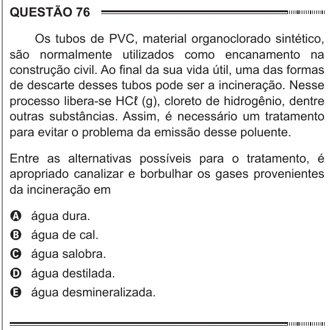

Texto extraído (pode conter ruído)

QUESTÃO 76  
Os tubos de PVC, material organoclorado sintético,  
são normalmente utilizados como encanamento na  
construção civil. Ao final da sua vida útil, uma das formas  
de descarte desses tubos pode ser a incineração. Nesse  
processo libera-se HCℓ (g), cloreto de hidrogênio, dentre  
outras substâncias. Assim, é necessário um tratamento  
para evitar o problema da emissão desse poluente.  
Entre as alternativas possíveis para o tratamento, é  
apropriado canalizar e borbulhar os gases provenientes  
da incineração em  
A água dura.  
B água de cal.  
C água salobra.  
D água destilada.  
E água desmineralizada.

