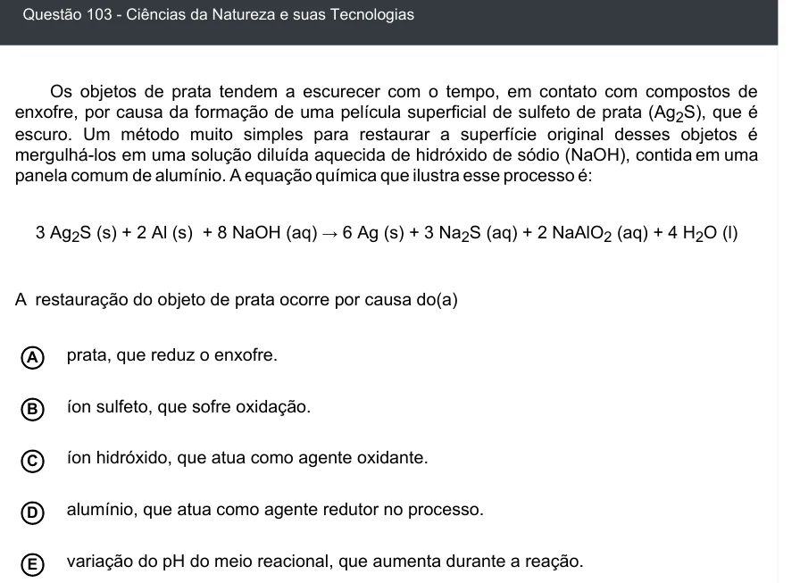

Texto extraído (pode conter ruído)

Questão 103 - Ciências da Natureza e suas Tecnologias  
Os objetos de prata tendem a escurecer com o tempo, em contato com compostos de  
enxofre, por causa da formação de uma película superficial de sulfeto de prata (Ag 2 S), que é  
escuro. Um método muito simples para restaurar a superfície original desses objetos é  
mergulhá-los em uma solução diluída aquecida de hidróxido de sódio (NaOH), contida em uma  
panela comum de alumínio. A equação química que ilustra esse processo é:  
3 Ag 2 S (s) + 2 Al (s) + 8 NaOH (aq) → 6 Ag (s) + 3 Na 2 S (aq) + 2 NaAlO 2 (aq) + 4 H 2 O (l)  
A restauração do objeto de prata ocorre por causa do(a)  
prata, que reduz o enxofre.  
A  
íon sulfeto, que sofre oxidação.  
B  
íon hidróxido, que atua como agente oxidante.  
C  
D  
alumínio, que atua como agente redutor no processo.  
variação do pH do meio reacional, que aumenta durante a reação.  
E

