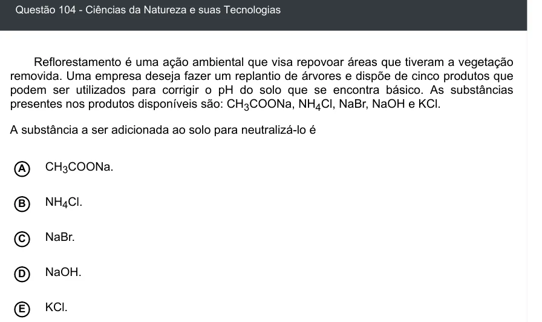

Texto extraído (pode conter ruído)

Questão 104 - Ciências da Natureza e suas Tecnologias  
Reflorestamento é uma ação ambiental que visa repovoar áreas que tiveram a vegetação  
removida. Uma empresa deseja fazer um replantio de árvores e dispõe de cinco produtos que  
podem ser utilizados para corrigir o pH do solo que se encontra básico. As substâncias  
presentes nos produtos disponíveis são: CH 3 COONa, NH 4 Cl, NaBr, NaOH e KCl.  
A substância a ser adicionada ao solo para neutralizá-lo é  
CH 3 COONa.  
A  
B  
NH 4 Cl.  
NaBr.  
C  
NaOH.  
D  
E  
KCl.

