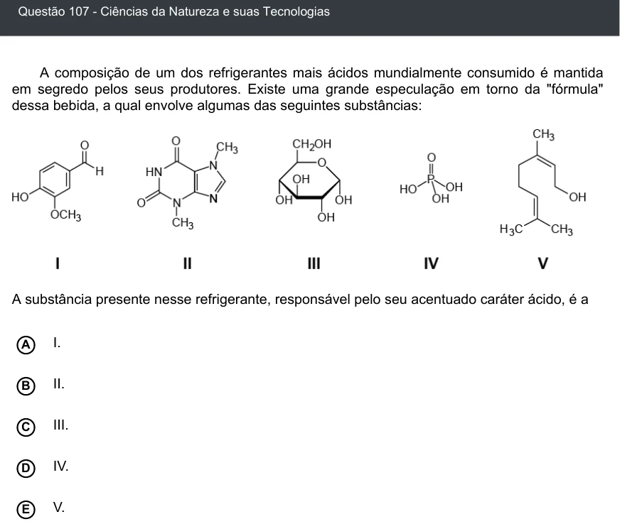

Texto extraído (pode conter ruído)

Questão 107 - Ciências da Natureza e suas Tecnologias  
A composição de um dos refrigerantes mais ácidos mundialmente consumido é mantida  
em segredo pelos seus produtores. Existe uma grande especulação em torno da "fórmula"  
dessa bebida, a qual envolve algumas das seguintes substâncias:  
A substância presente nesse refrigerante, responsável pelo seu acentuado caráter ácido, é a  
A  
I.  
II.  
B  
III.  
C  
IV.  
D  
E  
V.

