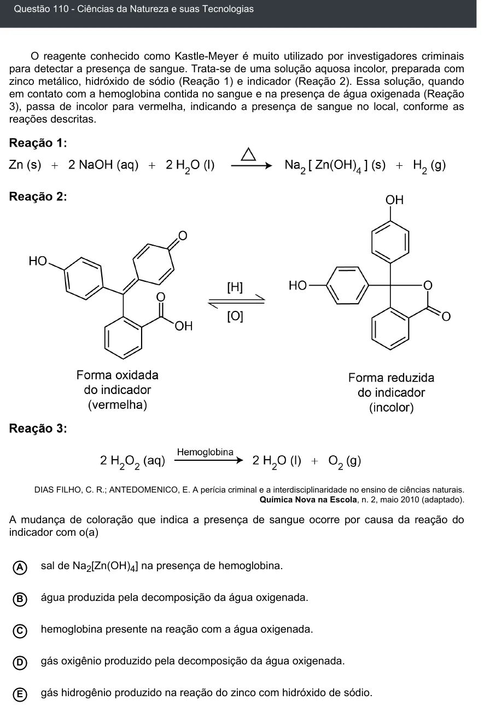

Texto extraído (pode conter ruído)

Questão 110 - Ciências da Natureza e suas Tecnologias  
O reagente conhecido como Kastle-Meyer é muito utilizado por investigadores criminais  
para detectar a presença de sangue. Trata-se de uma solução aquosa incolor, preparada com  
zinco metálico, hidróxido de sódio (Reação 1) e indicador (Reação 2). Essa solução, quando  
em contato com a hemoglobina contida no sangue e na presença de água oxigenada (Reação  
3), passa de incolor para vermelha, indicando a presença de sangue no local, conforme as  
reações descritas.  
DIAS FILHO, C. R.; ANTEDOMENICO, E. A perícia criminal e a interdisciplinaridade no ensino de ciências naturais.  
Química Nova na Escola, n. 2, maio 2010 (adaptado).  
A mudança de coloração que indica a presença de sangue ocorre por causa da reação do  
indicador com o(a)  
A  
sal de Na 2 [Zn(OH) 4 ] na presença de hemoglobina.  
água produzida pela decomposição da água oxigenada.  
B  
hemoglobina presente na reação com a água oxigenada.  
C  
D  
gás oxigênio produzido pela decomposição da água oxigenada.  
gás hidrogênio produzido na reação do zinco com hidróxido de sódio.  
E

