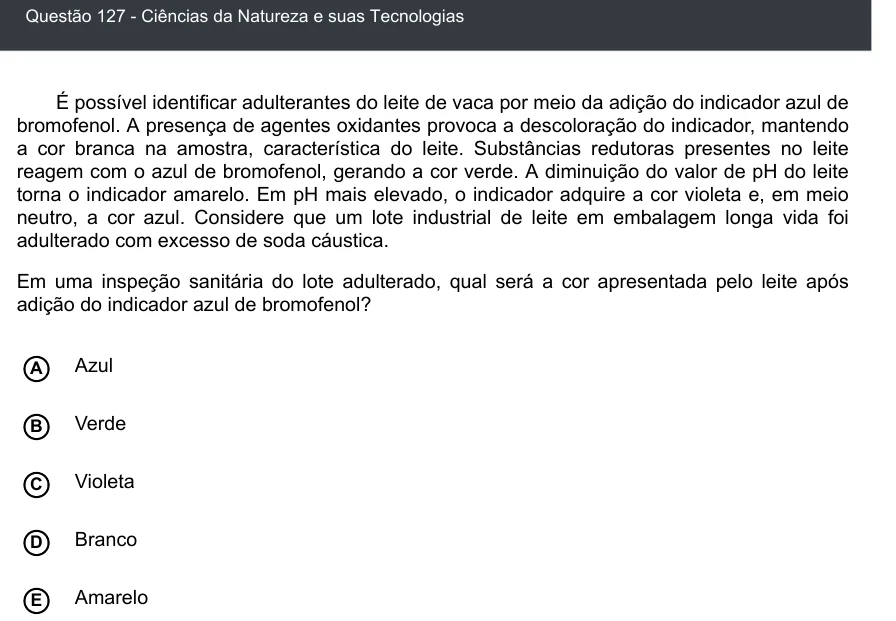

Texto extraído (pode conter ruído)

Questão 127 - Ciências da Natureza e suas Tecnologias  
É possível identificar adulterantes do leite de vaca por meio da adição do indicador azul de  
bromofenol. A presença de agentes oxidantes provoca a descoloração do indicador, mantendo  
a cor branca na amostra, característica do leite. Substâncias redutoras presentes no leite  
reagem com o azul de bromofenol, gerando a cor verde. A diminuição do valor de pH do leite  
torna o indicador amarelo. Em pH mais elevado, o indicador adquire a cor violeta e, em meio  
neutro, a cor azul. Considere que um lote industrial de leite em embalagem longa vida foi  
adulterado com excesso de soda cáustica.  
Em uma inspeção sanitária do lote adulterado, qual será a cor apresentada pelo leite após  
adição do indicador azul de bromofenol?  
Azul  
A  
Verde  
B  
Violeta  
C  
D  
Branco  
Amarelo  
E

