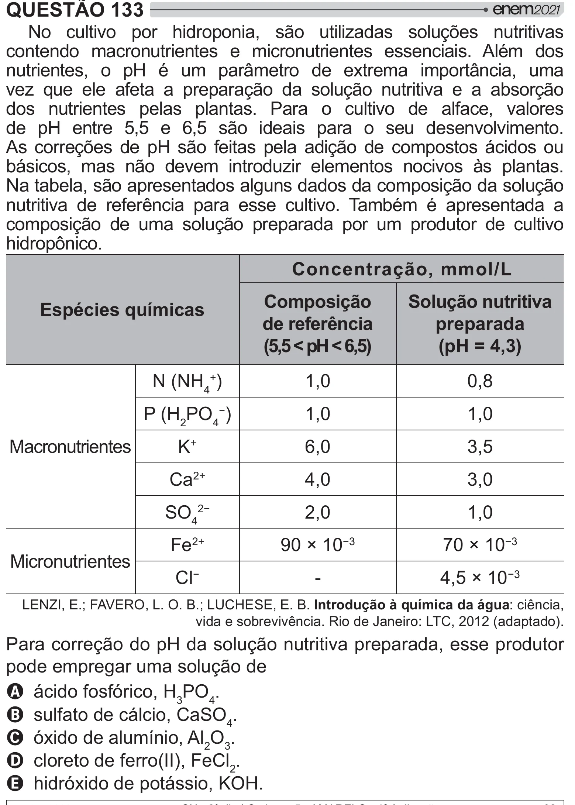

Texto extraído (pode conter ruído)

QUESTÃO 133  
No cultivo por hidroponia, são utilizadas soluções nutritivas  
contendo macronutrientes e micronutrientes essenciais. Além dos  
nutrientes, o pH é um parâmetro de extrema importância, uma  
vez que ele afeta a preparação da solução nutritiva e a absorção  
dos nutrientes pelas plantas. Para o cultivo de alface, valores  
de pH entre 5,5 e 6,5 são ideais para o seu desenvolvimento.  
As correções de pH são feitas pela adição de compostos ácidos ou  
básicos, mas não devem introduzir elementos nocivos às plantas.  
Na tabela, são apresentados alguns dados da composição da solução  
nutritiva de referência para esse cultivo. Também é apresentada a  
composição de uma solução preparada por um produtor de cultivo  
$#2!  
Concentração, mmol/L  
Composição  
Solução nutritiva  
Espécies químicas  
de referência  
preparada  
(5,5 < pH < 6,5)  
(pH = 4,3)  
N (NH 4+ )  
1,0  
0,8  
P (H 2 PO 4 )  
1,0  
1,0  
Macronutrientes  
K +  
6,0  
3,5  
Ca 2+  
4,0  
3,0  
SO 4‘  
2,0  
1,0  
Fe 2+  
90 × 10 ®  
70 × 10 ®  
Micronutrientes  
Cl   
-  
4,5 × 10 ®  
LENZI, E.; FAVERO, L. O. B.; LUCHESE, E. B. Introdução à química da água: ciência,  
vida e sobrevivência. Rio de Janeiro: LTC, 2012 (adaptado).  
Para correção do pH da solução nutritiva preparada, esse produtor  
pode empregar uma solução de  
A ácido fosfórico, H 3 PO 4 .  
B sulfato de cálcio, CaSO 4 .  
C óxido de alumínio, Al 2 O 3 .  
D cloreto de ferro(II), FeCl 2 .  
E hidróxido de potássio, KOH.

