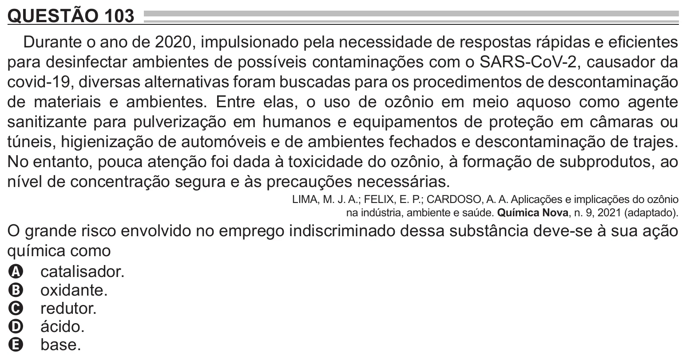

Texto extraído (pode conter ruído)

QUESTÃO 103  
Durante o ano de 2020, impulsionado pela necessidade de respostas rápidas e eficientes  
para desinfectar ambientes de possíveis contaminações com o SARS-CoV-2, causador da  
covid-19, diversas alternativas foram buscadas para os procedimentos de descontaminação  
de materiais e ambientes. Entre elas, o uso de ozônio em meio aquoso como agente  
sanitizante para pulverização em humanos e equipamentos de proteção em câmaras ou  
túneis, higienização de automóveis e de ambientes fechados e descontaminação de trajes.  
No entanto, pouca atenção foi dada à toxicidade do ozônio, à formação de subprodutos, ao  
nível de concentração segura e às precauções necessárias.  
LIMA, M. J. A.; FELIX, E. P.; CARDOSO, A. A. Aplicações e implicações do ozônio  
na indústria, ambiente e saúde. Química Nova, n. 9, 2021 (adaptado).  
O grande risco envolvido no emprego indiscriminado dessa substância deve-se à sua ação  
química como  
A catalisador.  
B oxidante.  
C redutor.  
D ácido.  
E base.

