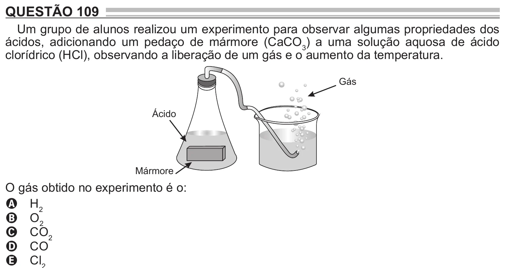

Texto extraído (pode conter ruído)

QUESTÃO 109  
Um grupo de alunos realizou um experimento para observar algumas propriedades dos  
ácidos, adicionando um pedaço de mármore (CaCO 3 ) a uma solução aquosa de ácido  
clorídrico (HCl), observando a liberação de um gás e o aumento da temperatura.  
Gás  
Ácido  
Mármore  
O gás obtido no experimento é o:  
A H 2  
B O 2  
C CO 2  
D CO

