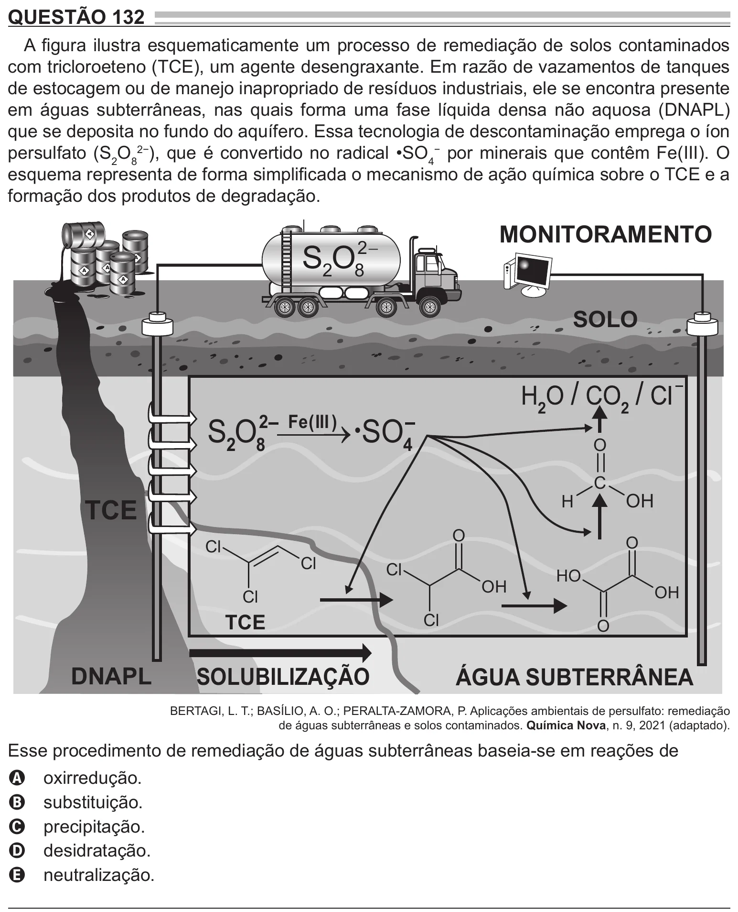

Texto extraído (pode conter ruído)

QUESTÃO 132  
A figura ilustra esquematicamente um processo de remediação de solos contaminados  
com tricloroeteno (TCE), um agente desengraxante. Em razão de vazamentos de tanques  
de estocagem ou de manejo inapropriado de resíduos industriais, ele se encontra presente  
em águas subterrâneas, nas quais forma uma fase líquida densa não aquosa (DNAPL)  
que se deposita no fundo do aquífero. Essa tecnologia de descontaminação emprega o íon  
persulfato (S 2 O 8 2− ), que é convertido no radical •SO 4− por minerais que contêm Fe(III). O  
esquema representa de forma simplificada o mecanismo de ação química sobre o TCE e a  
formação dos produtos de degradação.  
MONITORAMENTO  
A  
S 2 O  
2−  
A  
8  
A  
A  
A  
SOLO  
⋅ SO  
2  
Fe ( III )  
S 2 O  
8  
4  
O  
C  
OH  
TCE  
H  
O  
O  
Cl  
Cl  
Cl  
H O  
OH  
OH  
Cl  
TCE  
Cl  
O  
DNAPL  
SOLUBILIZAÇÃO  
ÁGUA SUBTERRÂNEA  
BERTAGI, L. T.; BASÍLIO, A. O.; PERALTA-ZAMORA, P. Aplicações ambientais de persulfato: remediação  
de águas subterrâneas e solos contaminados. Química Nova, n. 9, 2021 (adaptado).  
Esse procedimento de remediação de águas subterrâneas baseia-se em reações de  
oxirredução.  
A  
substituição.  
B  
precipitação.  
C  
desidratação.  
D  
neutralização.  
E

