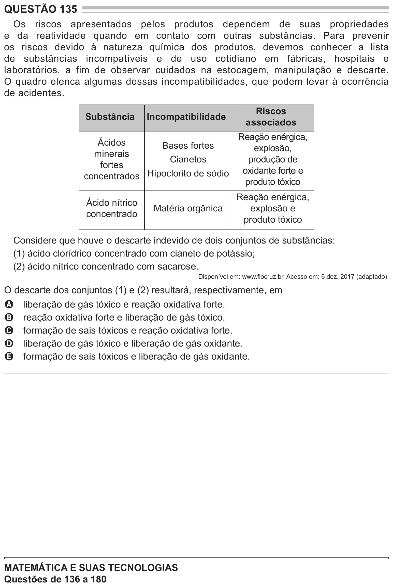

Texto extraído (pode conter ruído)

QUESTÃO 135  
Os riscos apresentados pelos produtos dependem de suas propriedades  
e da reatividade quando em contato com outras substâncias. Para prevenir  
os riscos devido à natureza química dos produtos, devemos conhecer a lista  
de substâncias incompatíveis e de uso cotidiano em fábricas, hospitais e  
laboratórios, a fim de observar cuidados na estocagem, manipulação e descarte.  
O quadro elenca algumas dessas incompatibilidades, que podem levar à ocorrência  
de acidentes.  
Riscos  
Substância  
Incompatibilidade  
associados  
Reação enérgica,  
Ácidos  
Bases fortes  
explosão,  
minerais  
Cianetos  
produção de  
fortes  
oxidante forte e  
concentrados Hipoclorito de sódio  
produto tóxico  
Reação enérgica,  
Ácido nítrico  
Matéria orgânica  
explosão e  
concentrado  
produto tóxico  
Considere que houve o descarte indevido de dois conjuntos de substâncias:  
(1) ácido clorídrico concentrado com cianeto de potássio;  
(2) ácido nítrico concentrado com sacarose.  
Disponível em: www.fiocruz.br. Acesso em: 6 dez. 2017 (adaptado).  
O descarte dos conjuntos (1) e (2) resultará, respectivamente, em  
liberação de gás tóxico e reação oxidativa forte.  
A  
reação oxidativa forte e liberação de gás tóxico.  
B  
formação de sais tóxicos e reação oxidativa forte.  
C  
liberação de gás tóxico e liberação de gás oxidante.  
D  
formação de sais tóxicos e liberação de gás oxidante.  
E  
MATEMÁTICA E SUAS TECNOLOGIAS

