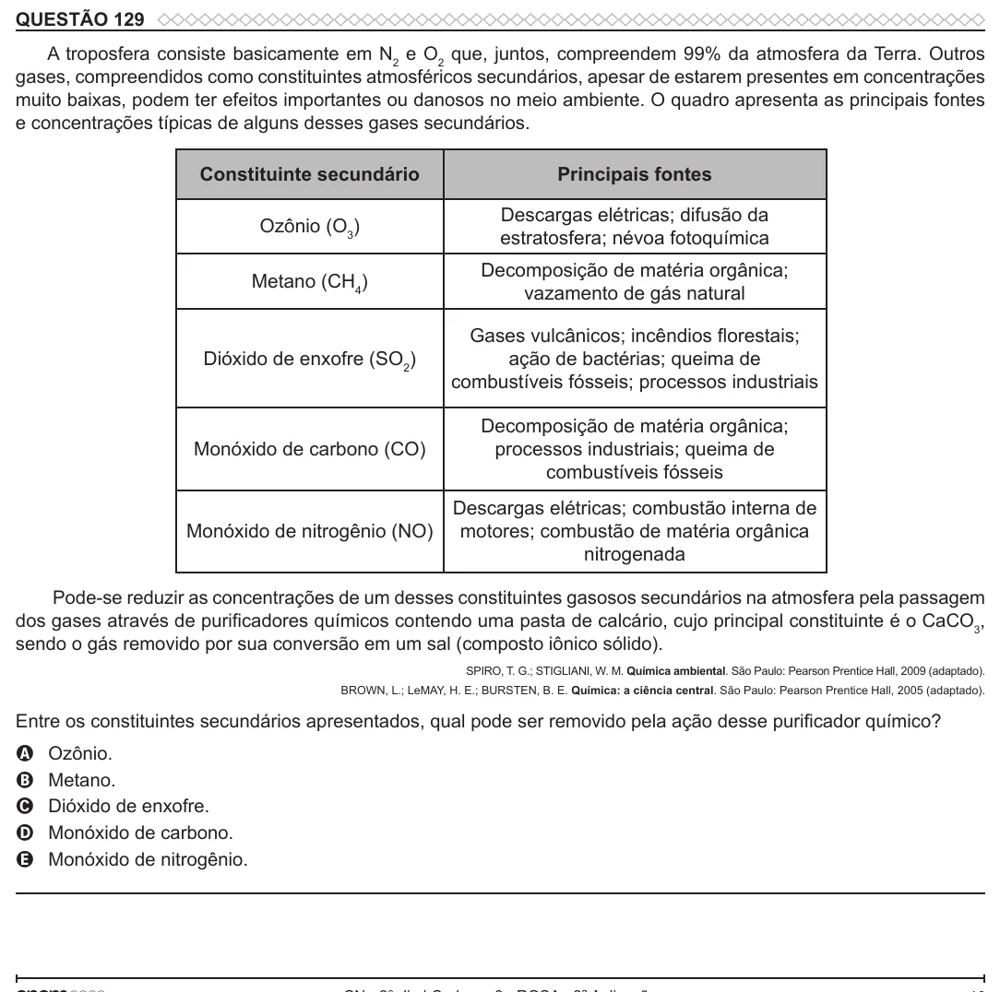

Texto extraído (pode conter ruído)

QUESTÃO 129  
A troposfera consiste basicamente em N 2 e O 2 que, juntos, compreendem 99% da atmosfera da Terra. Outros  
gases, compreendidos como constituintes atmosféricos secundários, apesar de estarem presentes em concentrações  
muito baixas, podem ter efeitos importantes ou danosos no meio ambiente. O quadro apresenta as principais fontes  
e concentrações típicas de alguns desses gases secundários.  
Constituinte secundário  
Principais fontes  
Descargas elétricas; difusão da  
Ozônio (O 3 )  
estratosfera; névoa fotoquímica  
Decomposição de matéria orgânica;  
Metano (CH 4 )  
vazamento de gás natural  
Gases vulcânicos; incêndios fl orestais;  
Dióxido de enxofre (SO 2 )  
ação de bactérias; queima de  
combustíveis fósseis; processos industriais  
Decomposição de matéria orgânica;  
Monóxido de carbono (CO)  
processos industriais; queima de  
combustíveis fósseis  
Descargas elétricas; combustão interna de  
Monóxido de nitrogênio (NO)  
motores; combustão de matéria orgânica  
nitrogenada  
Pode-se reduzir as concentrações de um desses constituintes gasosos secundários na atmosfera pela passagem  
dos gases através de purificadores químicos contendo uma pasta de calcário, cujo principal constituinte é o CaCO 3 ,  
sendo o gás removido por sua conversão em um sal (composto iônico sólido).  
SPIRO, T. G.; STIGLIANI, W. M. Química ambiental. São Paulo: Pearson Prentice Hall, 2009 (adaptado).  
BROWN, L.; LeMAY, H. E.; BURSTEN, B. E. Química: a ciência central. São Paulo: Pearson Prentice Hall, 2005 (adaptado).  
Entre os constituintes secundários apresentados, qual pode ser removido pela ação desse purificador químico?  
Ozônio.  
A  
B  
Metano.  
Dióxido de enxofre.  
C  
Monóxido de carbono.  
D  
Monóxido de nitrogênio.  
E

