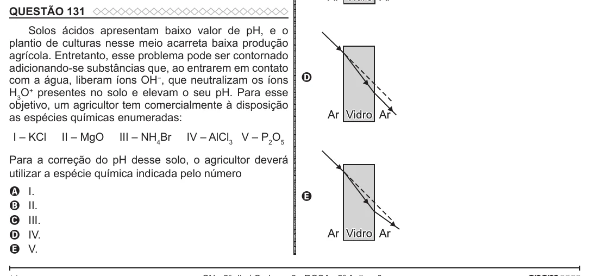

Texto extraído (pode conter ruído)

QUESTÃO 131  
Solos ácidos apresentam baixo valor de pH, e o  
plantio de culturas nesse meio acarreta baixa produção  
agrícola. Entretanto, esse problema pode ser contornado  
adicionando-se substâncias que, ao entrarem em contato  
com a água, liberam íons OH − , que neutralizam os íons  
D  
H 3 O + presentes no solo e elevam o seu pH. Para esse  
objetivo, um agricultor tem comercialmente à disposição  
as espécies químicas enumeradas:  
I – KCl  
II – MgO  
III – NH 4 Br  
IV – AlCl 3 V – P 2 O 5  
Para a correção do pH desse solo, o agricultor deverá  
utilizar a espécie química indicada pelo número  
I.  
A  
E  
B  
II.  
III.  
C  
IV.  
D  
V.  
E

