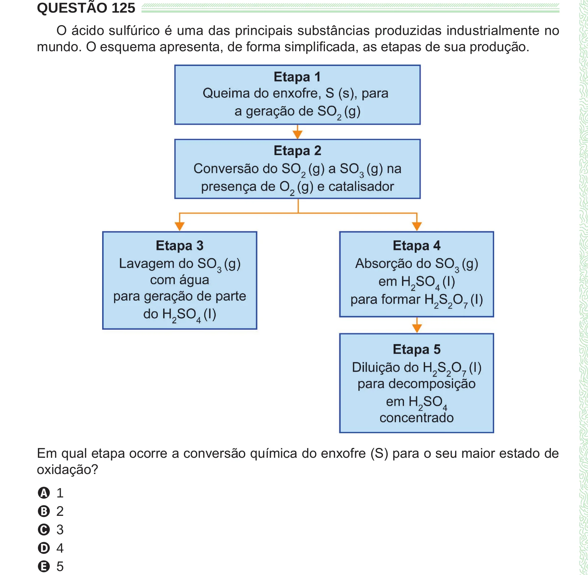

Texto extraído (pode conter ruído)

QUESTÃO 125  
O ácido sulfúrico é uma das principais substâncias produzidas industrialmente no  
mundo. O esquema apresenta, de forma simplificada, as etapas de sua produção.  
Em qual etapa ocorre a conversão química do enxofre (S) para o seu maior estado de  
oxidação?  
A 1  
B 2  
C 3  
D 4  
E 5

