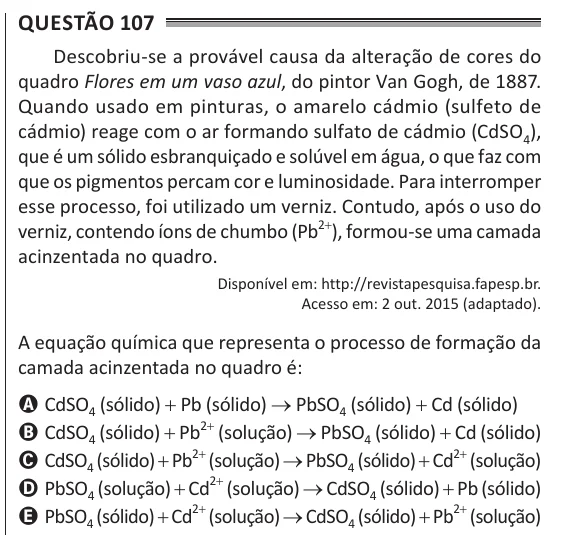

Texto extraído (pode conter ruído)

Questão 107  
Descobriu-se a provável causa da alteração de cores do  
quadro Flores em um vaso azul, do pintor Van Gogh, de 1887.  
Quando usado em pinturas, o amarelo cádmio (sulfeto de  
cádmio) reage com o ar formando sulfato de cádmio (CdSO 4 ),  
que é um sólido esbranquiçado e solúvel em água, o que faz com  
que os pigmentos percam cor e luminosidade. Para interromper  
esse processo, foi utilizado um verniz. Contudo, após o uso do  
verniz, contendo íons de chumbo (Pb 2+ ), formou-se uma camada  
acinzentada no quadro.  
Disponível em: http://revistapesquisa.fapesp.br.  
Acesso em: 2 out. 2015 (adaptado).  
A equação química que representa o processo de formação da  
camada acinzentada no quadro é:  
A CdSO 4 (sólido) + Pb (sólido) → PbSO 4 (sólido) + Cd (sólido)  
B CdSO 4 (sólido) + Pb 2+ (solução) → PbSO 4 (sólido) + Cd (sólido)  
C CdSO 4 (sólido) + Pb 2+ (solução) → PbSO 4 (sólido) + Cd 2+ (solução)  
D PbSO 4 (solução) + Cd 2+ (solução) → CdSO 4 (sólido) + Pb (sólido)  
E PbSO 4 (sólido) + Cd 2+ (solução) → CdSO 4 (sólido) + Pb 2+ (solução)

