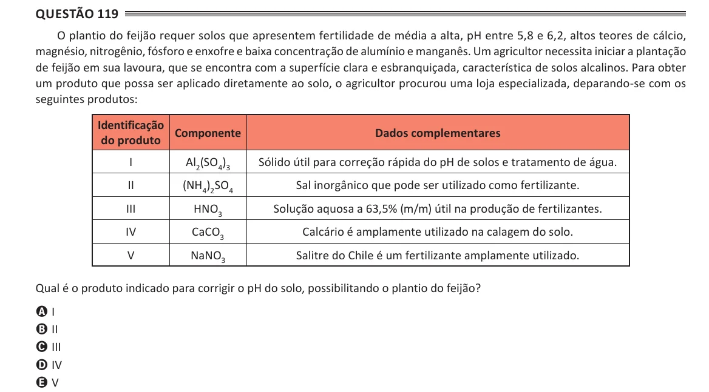

Texto extraído (pode conter ruído)

Questão 119  
O plantio do feijão requer solos que apresentem fertilidade de média a alta, pH entre 5,8 e 6,2, altos teores de cálcio,  
magnésio, nitrogênio, fósforo e enxofre e baixa concentração de alumínio e manganês. Um agricultor necessita iniciar a plantação  
de feijão em sua lavoura, que se encontra com a superfície clara e esbranquiçada, característica de solos alcalinos. Para obter  
um produto que possa ser aplicado diretamente ao solo, o agricultor procurou uma loja especializada, deparando-se com os  
seguintes produtos:  
Identificação  
Componente  
Dados complementares  
do produto  
I  
Al 2 (SO 4 ) 3  
Sólido útil para correção rápida do pH de solos e tratamento de água.  
II  
(NH 4 ) 2 SO 4  
Sal inorgânico que pode ser utilizado como fertilizante.  
III  
HNO 3  
Solução aquosa a 63,5% (m/m) útil na produção de fertilizantes.  
IV  
CaCO 3  
Calcário é amplamente utilizado na calagem do solo.  
V  
NaNO 3  
Salitre do Chile é um fertilizante amplamente utilizado.  
Qual é o produto indicado para corrigir o pH do solo, possibilitando o plantio do feijão?  
A I  
B II  
C III  
D IV  
E V

