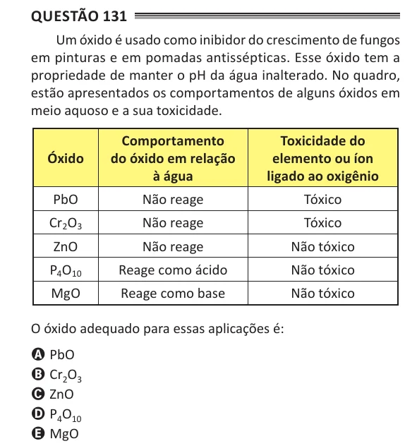

Texto extraído (pode conter ruído)

Questão 131  
Um óxido é usado como inibidor do crescimento de fungos  
em pinturas e em pomadas antissépticas. Esse óxido tem a  
propriedade de manter o pH da água inalterado. No quadro,  
estão apresentados os comportamentos de alguns óxidos em  
meio aquoso e a sua toxicidade.  
Comportamento  
toxicidade do  
Óxido  
do óxido em relação  
elemento ou íon  
à água  
ligado ao oxigênio  
PbO  
Não reage  
Tóxico  
Cr 2 O 3  
Não reage  
Tóxico  
ZnO  
Não reage  
Não tóxico  
P 4 O 10  
Reage como ácido  
Não tóxico  
MgO  
Reage como base  
Não tóxico  
O óxido adequado para essas aplicações é:  
A PbO  
B Cr 2 O 3  
C ZnO  
D P 4 O 10  
E MgO

