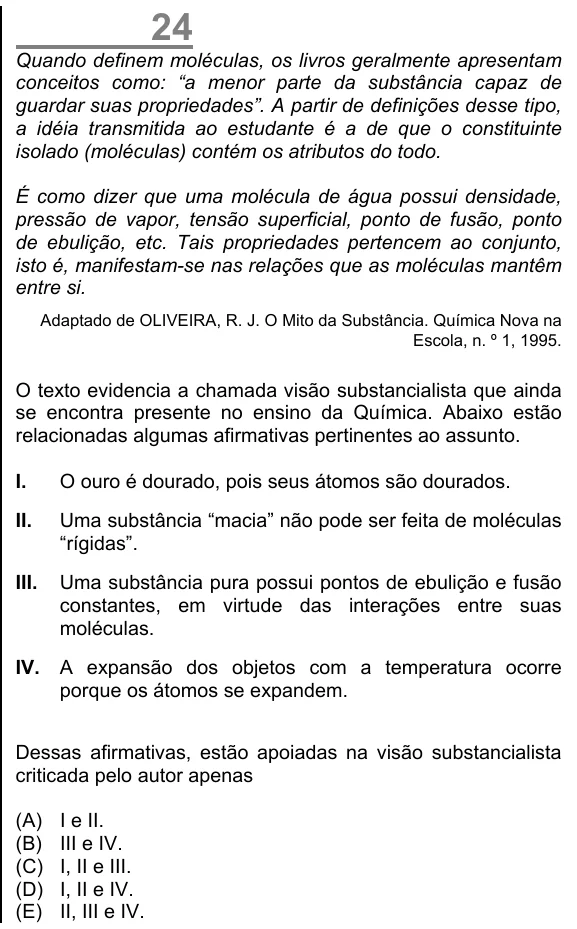

Texto extraído (pode conter ruído)

24  
Quando definem moléculas, os livros geralmente apresentam  
conceitos como: “a menor parte da substância capaz de  
guardar suas propriedades”. A partir de definições desse tipo,  
a idéia transmitida ao estudante é a de que o constituinte  
isolado (moléculas) contém os atributos do todo.  
É como dizer que uma molécula de água possui densidade,  
pressão de vapor, tensão superficial, ponto de fusão, ponto  
de ebulição, etc. Tais propriedades pertencem ao conjunto,  
isto é, manifestam-se nas relações que as moléculas mantêm  
entre si.  
Adaptado de OLIVEIRA, R. J. O Mito da Substância. Química Nova na  
Escola, n. º 1, 1995.  
O texto evidencia a chamada visão substancialista que ainda  
se encontra presente no ensino da Química. Abaixo estão  
relacionadas algumas afirmativas pertinentes ao assunto.  
I.  
O ouro é dourado, pois seus átomos são dourados.  
II.  
Uma substância “macia” não pode ser feita de moléculas  
“rígidas”.  
III.  
Uma substância pura possui pontos de ebulição e fusão  
constantes, em virtude das interações entre suas  
moléculas.  
IV.  
A expansão dos objetos com a temperatura ocorre  
porque os átomos se expandem.  
Dessas afirmativas, estão apoiadas na visão substancialista  
criticada pelo autor apenas  
(A)  
I e II.  
(B)  
III e IV.  
(C)  
I, II e III.  
(D)  
I, II e IV.  
(E)  
II, III e IV.

