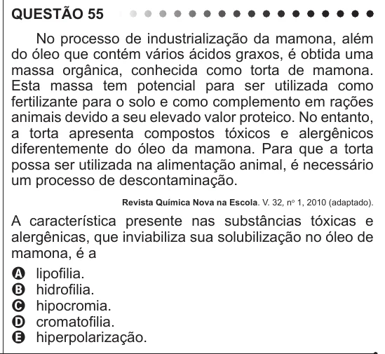

Texto extraído (pode conter ruído)

QUESTÃO 55  
No processo de industrialização da mamona, além  
do óleo que contém vários ácidos graxos, é obtida uma  
massa orgânica, conhecida como torta de mamona.  
Esta massa tem potencial para ser utilizada como  
fertilizante para o solo e como complemento em rações  
animais devido a seu elevado valor proteico. No entanto,  
a torta apresenta compostos tóxicos e alergênicos  
diferentemente do óleo da mamona. Para que a torta  
possa ser utilizada na alimentação animal, é necessário  
um processo de descontaminação.  
Revista Química Nova na Escola. V. 32, n o 1, 2010 (adaptado).  
A característica presente nas substâncias tóxicas e  
alergênicas, que inviabiliza sua solubilização no óleo de  
mamona, é a  
A lipofilia.  
B hidrofilia.  
C hipocromia.  
D cromatofilia.  
E hiperpolarização.

