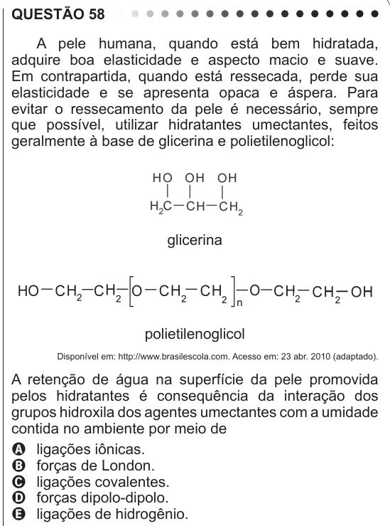

Texto extraído (pode conter ruído)

QUESTÃO 58  
A pele humana, quando está bem hidratada,  
adquire boa elasticidade e aspecto macio e suave.  
Em contrapartida, quando está ressecada, perde sua  
elasticidade e se apresenta opaca e áspera. Para  
evitar o ressecamento da pele é necessário, sempre  
que possível, utilizar hidratantes umectantes, feitos  
geralmente à base de glicerina e polietilenoglicol:  
glicerina  
polietilenoglicol  
Disponível em: http://www.brasilescola.com. Acesso em: 23 abr. 2010 (adaptado).  
A retenção de água na superfície da pele promovida  
pelos hidratantes é consequência da interação dos  
grupos hidroxila dos agentes umectantes com a umidade  
contida no ambiente por meio de  
A ligações iônicas.  
B forças de London.  
C ligações covalentes.  
D forças dipolo-dipolo.  
E ligações de hidrogênio.

