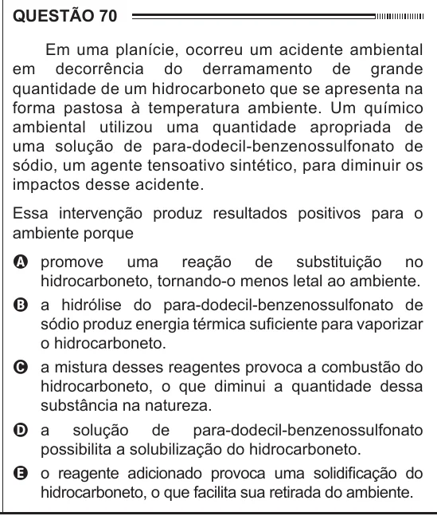

Texto extraído (pode conter ruído)

QUESTÃO 70  
Em uma planície, ocorreu um acidente ambiental  
em decorrência do derramamento de grande  
quantidade de um hidrocarboneto que se apresenta na  
forma pastosa à temperatura ambiente. Um químico  
ambiental utilizou uma quantidade apropriada de  
uma solução de para-dodecil-benzenossulfonato de  
sódio, um agente tensoativo sintético, para diminuir os  
impactos desse acidente.  
Essa intervenção produz resultados positivos para o  
ambiente porque  
A promove uma reação de substituição no  
hidrocarboneto, tornando-o menos letal ao ambiente.  
B a hidrólise do para-dodecil-benzenossulfonato de  
sódio produz energia térmica suficiente para vaporizar  
o hidrocarboneto.  
C a mistura desses reagentes provoca a combustão do  
hidrocarboneto, o que diminui a quantidade dessa  
substância na natureza.  
D a solução de para-dodecil-benzenossulfonato  
possibilita a solubilização do hidrocarboneto.  
E o reagente adicionado provoca uma solidificação do  
hidrocarboneto, o que facilita sua retirada do ambiente.

