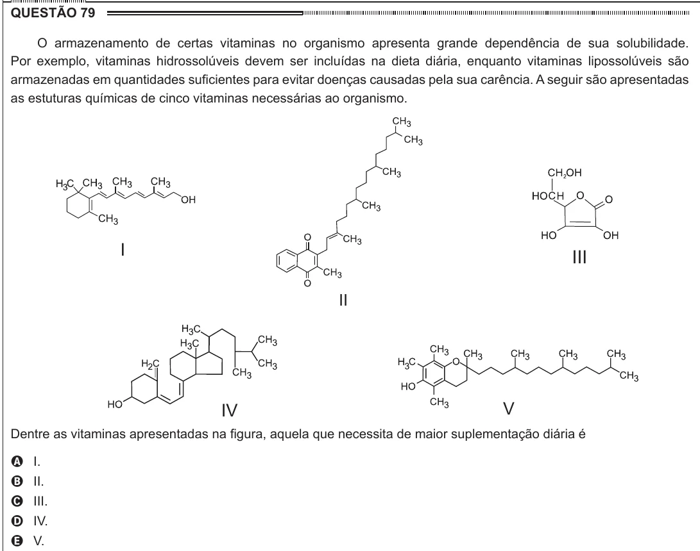

Texto extraído (pode conter ruído)

QUESTÃO 79  
O armazenamento de certas vitaminas no organismo apresenta grande dependência de sua solubilidade.  
Por exemplo, vitaminas hidrossolúveis devem ser incluídas na dieta diária, enquanto vitaminas lipossolúveis são  
armazenadas em quantidades suficientes para evitar doenças causadas pela sua carência. A seguir são apresentadas  
as estuturas químicas de cinco vitaminas necessárias ao organismo.  
I  
III  
II  
V  
IV  
Dentre as vitaminas apresentadas na figura, aquela que necessita de maior suplementação diária é  
A I.  
B II.  
C III.  
D IV.  
E V.

