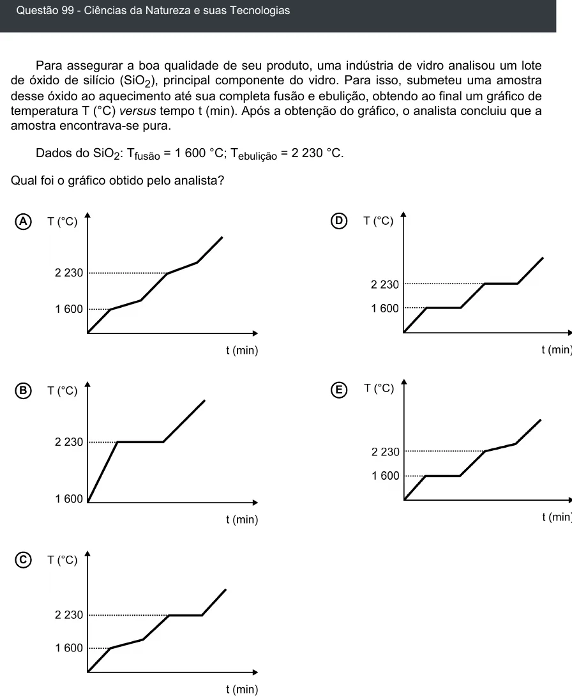

Texto extraído (pode conter ruído)

Questão 99 - Ciências da Natureza e suas Tecnologias  
Para assegurar a boa qualidade de seu produto, uma indústria de vidro analisou um lote  
de óxido de silício (SiO 2 ), principal componente do vidro. Para isso, submeteu uma amostra  
desse óxido ao aquecimento até sua completa fusão e ebulição, obtendo ao final um gráfico de  
temperatura T (°C) versus tempo t (min). Após a obtenção do gráfico, o analista concluiu que a  
amostra encontrava-se pura.  
Dados do SiO 2 : T fusão = 1 600 °C; T ebulição = 2 230 °C.  
Qual foi o gráfico obtido pelo analista?  
A  
D  
B  
E  
C

