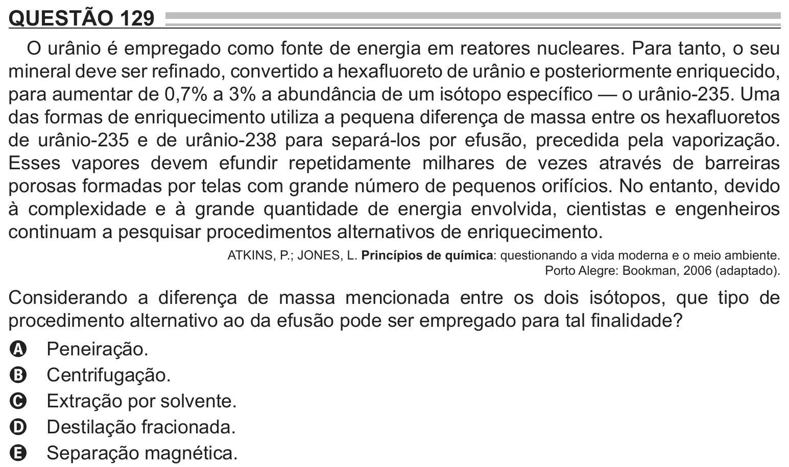

Texto extraído (pode conter ruído)

QUESTÃO 129  
O urânio é empregado como fonte de energia em reatores nucleares. Para tanto, o seu  
mineral deve ser refinado, convertido a hexafluoreto de urânio e posteriormente enriquecido,  
para aumentar de 0,7% a 3% a abundância de um isótopo específico — o urânio-235. Uma  
das formas de enriquecimento utiliza a pequena diferença de massa entre os hexafluoretos  
de urânio-235 e de urânio-238 para separá-los por efusão, precedida pela vaporização.  
Esses vapores devem efundir repetidamente milhares de vezes através de barreiras  
porosas formadas por telas com grande número de pequenos orifícios. No entanto, devido  
à complexidade e à grande quantidade de energia envolvida, cientistas e engenheiros  
continuam a pesquisar procedimentos alternativos de enriquecimento.  
ATKINS, P.; JONES, L. Princípios de química: questionando a vida moderna e o meio ambiente.  
Porto Alegre: Bookman, 2006 (adaptado).  
Considerando a diferença de massa mencionada entre os dois isótopos, que tipo de  
procedimento alternativo ao da efusão pode ser empregado para tal finalidade?  
Peneiração.  
A  
Centrifugação.  
B  
Extração por solvente.  
C  
Destilação fracionada.  
D  
Separação magnética.  
E

