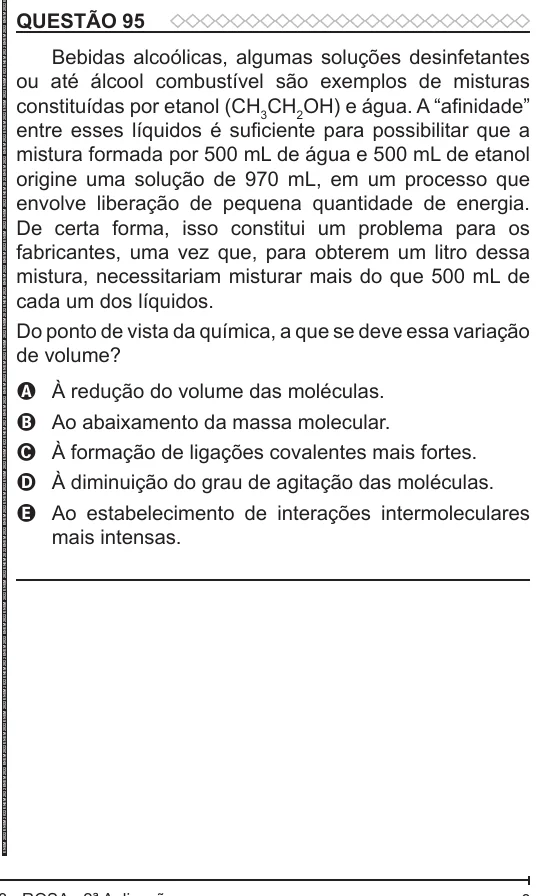

Texto extraído (pode conter ruído)

QUESTÃO 95  
Bebidas alcoólicas, algumas soluções desinfetantes  
ou até álcool combustível são exemplos de misturas  
constituídas por etanol (CH 3 CH 2 OH) e água. A “afinidade”  
entre esses líquidos é suficiente para possibilitar que a  
mistura formada por 500 mL de água e 500 mL de etanol  
origine uma solução de 970 mL, em um processo que  
envolve liberação de pequena quantidade de energia.  
De certa forma, isso constitui um problema para os  
fabricantes, uma vez que, para obterem um litro dessa  
mistura, necessitariam misturar mais do que 500 mL de  
cada um dos líquidos.  
Do ponto de vista da química, a que se deve essa variação  
de volume?  
À redução do volume das moléculas.  
A  
Ao abaixamento da massa molecular.  
B  
C  
À formação de ligações covalentes mais fortes.  
À diminuição do grau de agitação das moléculas.  
D  
Ao estabelecimento de interações intermoleculares  
E  
mais intensas.

