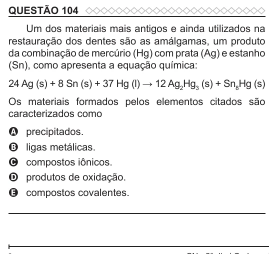

Texto extraído (pode conter ruído)

QUESTÃO 104  
Um dos materiais mais antigos e ainda utilizados na  
restauração dos dentes são as amálgamas, um produto  
da combinação de mercúrio (Hg) com prata (Ag) e estanho  
(Sn), como apresenta a equação química:  
24 Ag (s) + 8 Sn (s) + 37 Hg (l) → 12 Ag 2 Hg 3 (s) + Sn 8 Hg (s)  
Os materiais formados pelos elementos citados são  
caracterizados como  
precipitados.  
A  
ligas metálicas.  
B  
compostos iônicos.  
C  
produtos de oxidação.  
D  
E  
compostos covalentes.

