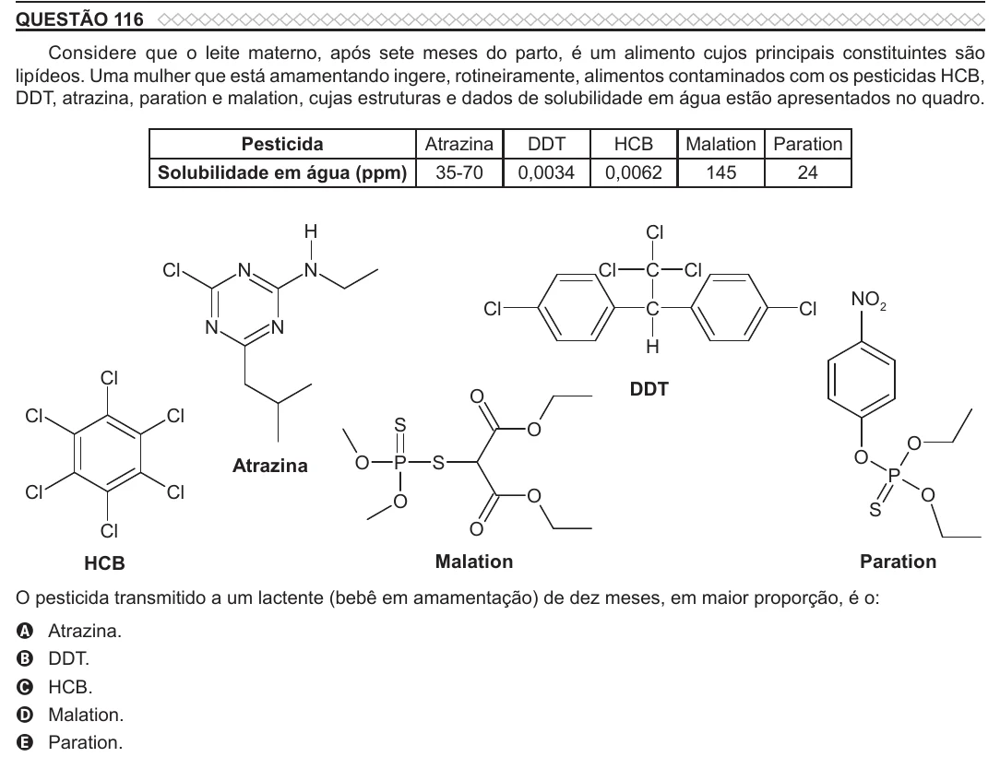

Texto extraído (pode conter ruído)

QUESTÃO 116  
Considere que o leite materno, após sete meses do parto, é um alimento cujos principais constituintes são  
lipídeos. Uma mulher que está amamentando ingere, rotineiramente, alimentos contaminados com os pesticidas HCB,  
DDT, atrazina, paration e malation, cujas estruturas e dados de solubilidade em água estão apresentados no quadro.  
Pesticida  
Atrazina  
DDT  
HCB  
Malation Paration  
Solubilidade em água (ppm)  
35-70  
0,0034  
0,0062  
145  
24  
H  
Cl  
Cl  
N  
N  
Cl  
C  
Cl  
NO 2  
Cl  
C  
Cl  
N  
N  
H  
Cl  
DDT  
O  
Cl  
Cl  
S  
O  
O  
O  
Atrazina  
O  
P  
S  
P  
Cl  
Cl  
O  
O  
O  
S  
Cl  
O  
HCB  
Malation  
Paration  
O pesticida transmitido a um lactente (bebê em amamentação) de dez meses, em maior proporção, é o:  
Atrazina.  
A  
B  
DDT.  
HCB.  
C  
Malation.  
D  
Paration.  
E

