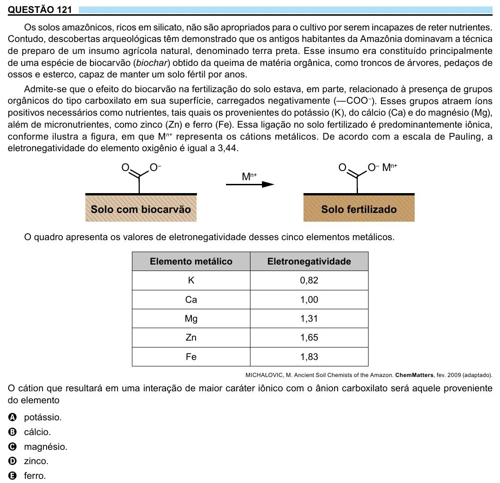

Texto extraído (pode conter ruído)

QUESTÃO 121  
Os solos amazônicos, ricos em silicato, não são apropriados para o cultivo por serem incapazes de reter nutrientes.  
Contudo, descobertas arqueológicas têm demonstrado que os antigos habitantes da Amazônia dominavam a técnica  
de preparo de um insumo agrícola natural, denominado terra preta. Esse insumo era constituído principalmente  
de uma espécie de biocarvão (biochar) obtido da queima de matéria orgânica, como troncos de árvores, pedaços de  
ossos e esterco, capaz de manter um solo fértil por anos.  
Admite-se que o efeito do biocarvão na fertilização do solo estava, em parte, relacionado à presença de grupos  
orgânicos do tipo carboxilato em sua superfície, carregados negativamente (—COO − ). Esses grupos atraem íons  
positivos necessários como nutrientes, tais quais os provenientes do potássio (K), do cálcio (Ca) e do magnésio (Mg),  
além de micronutrientes, como zinco (Zn) e ferro (Fe). Essa ligação no solo fertilizado é predominantemente iônica,  
conforme ilustra a figura, em que M n+ representa os cátions metálicos. De acordo com a escala de Pauling, a  
eletronegatividade do elemento oxigênio é igual a 3,44.  
O  
O –  
O  
O – M n+  
M n+  
Solo com biocarvão  
Solo fertilizado  
O quadro apresenta os valores de eletronegatividade desses cinco elementos metálicos.  
Elemento metálico  
Eletronegatividade  
K  
0,82  
Ca  
1,00  
Mg  
1,31  
Zn  
1,65  
Fe  
1,83  
MICHALOVIC, M. Ancient Soil Chemists of the Amazon. ChemMatters, fev. 2009 (adaptado).  
O cátion que resultará em uma interação de maior caráter iônico com o ânion carboxilato será aquele proveniente  
do elemento  
A potássio.  
B cálcio.  
C magnésio.  
D zinco.  
E ferro.

