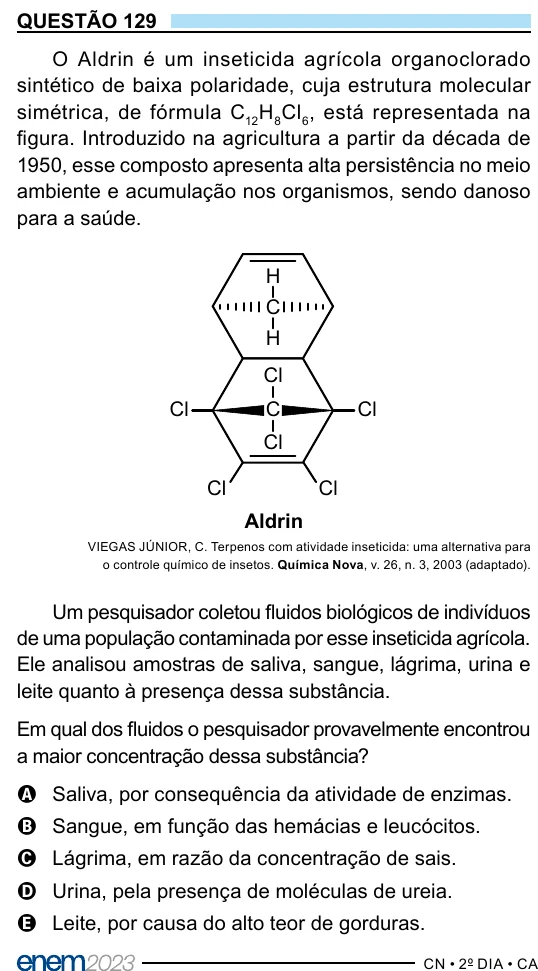

Texto extraído (pode conter ruído)

QUESTÃO 129  
O Aldrin é um inseticida agrícola organoclorado  
sintético de baixa polaridade, cuja estrutura molecular  
simétrica, de fórmula C 12 H 8 Cl 6 , está representada na  
figura. Introduzido na agricultura a partir da década de  
1950, esse composto apresenta alta persistência no meio  
ambiente e acumulação nos organismos, sendo danoso  
para a saúde.  
H  
C  
H  
Cl  
Cl  
C  
Cl  
Cl  
Cl  
Cl  
Aldrin  
VIEGAS JÚNIOR, C. Terpenos com atividade inseticida: uma alternativa para  
o controle químico de insetos. Química Nova, v. 26, n. 3, 2003 (adaptado).  
Um pesquisador coletou fluidos biológicos de indivíduos  
de uma população contaminada por esse inseticida agrícola.  
Ele analisou amostras de saliva, sangue, lágrima, urina e  
leite quanto à presença dessa substância.  
Em qual dos fluidos o pesquisador provavelmente encontrou  
a maior concentração dessa substância?  
A Saliva, por consequência da atividade de enzimas.  
B Sangue, em função das hemácias e leucócitos.  
C Lágrima, em razão da concentração de sais.  
D Urina, pela presença de moléculas de ureia.  
E Leite, por causa do alto teor de gorduras.

