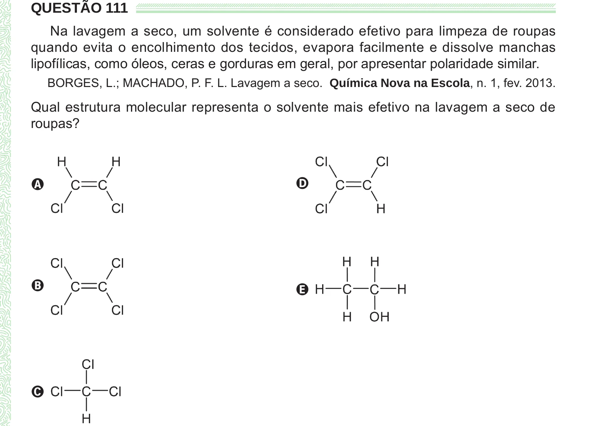

Texto extraído (pode conter ruído)

QUESTÃO 111  
Na lavagem a seco, um solvente é considerado efetivo para limpeza de roupas  
quando evita o encolhimento dos tecidos, evapora facilmente e dissolve manchas  
lipofílicas, como óleos, ceras e gorduras em geral, por apresentar polaridade similar.  
BORGES, L.; MACHADO, P. F. L. Lavagem a seco. Química Nova na Escola, n. 1, fev. 2013.  
Qual estrutura molecular representa o solvente mais efetivo na lavagem a seco de  
roupas?  
D  
A  
B  
E  
C

