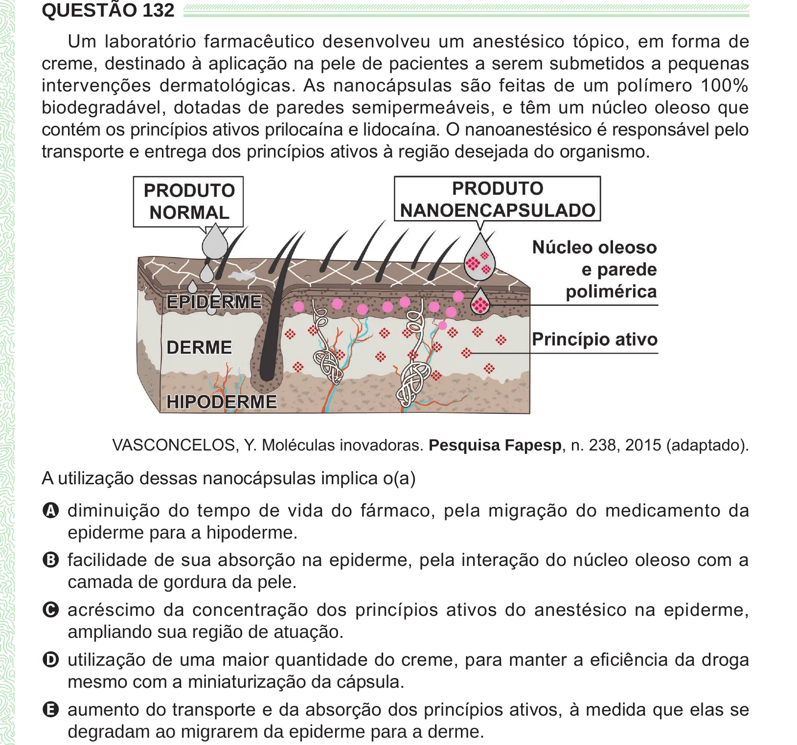

Texto extraído (pode conter ruído)

QUESTÃO 132  
Um laboratório farmacêutico desenvolveu um anestésico tópico, em forma de  
creme, destinado à aplicação na pele de pacientes a serem submetidos a pequenas  
intervenções dermatológicas. As nanocápsulas são feitas de um polímero 100%  
biodegradável, dotadas de paredes semipermeáveis, e têm um núcleo oleoso que  
contém os princípios ativos prilocaína e lidocaína. O nanoanestésico é responsável pelo  
transporte e entrega dos princípios ativos à região desejada do organismo.  
VASCONCELOS, Y. Moléculas inovadoras. Pesquisa Fapesp, n. 238, 2015 (adaptado).  
A utilização dessas nanocápsulas implica o(a)  
A diminuição do tempo de vida do fármaco, pela migração do medicamento da  
epiderme para a hipoderme.  
B facilidade de sua absorção na epiderme, pela interação do núcleo oleoso com a  
camada de gordura da pele.  
C acréscimo da concentração dos princípios ativos do anestésico na epiderme,  
ampliando sua região de atuação.  
D utilização de uma maior quantidade do creme, para manter a eficiência da droga  
mesmo com a miniaturização da cápsula.  
E aumento do transporte e da absorção dos princípios ativos, à medida que elas se  
degradam ao migrarem da epiderme para a derme.

