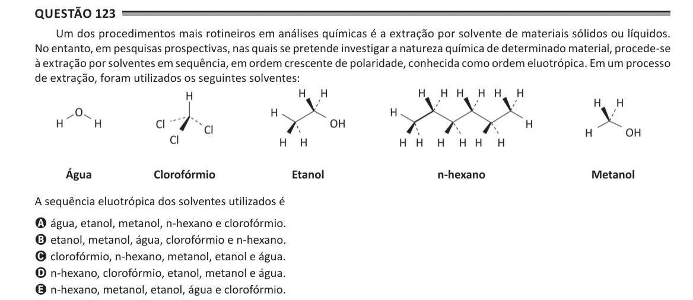

Texto extraído (pode conter ruído)

Questão 123  
Um dos procedimentos mais rotineiros em análises químicas é a extração por solvente de materiais sólidos ou líquidos.  
No entanto, em pesquisas prospectivas, nas quais se pretende investigar a natureza química de determinado material, procede-se  
à extração por solventes em sequência, em ordem crescente de polaridade, conhecida como ordem eluotrópica. Em um processo  
de extração, foram utilizados os seguintes solventes:  
A sequência eluotrópica dos solventes utilizados é  
A água, etanol, metanol, n-hexano e clorofórmio.  
B etanol, metanol, água, clorofórmio e n-hexano.  
C clorofórmio, n-hexano, metanol, etanol e água.  
D n-hexano, clorofórmio, etanol, metanol e água.  
E n-hexano, metanol, etanol, água e clorofórmio.

