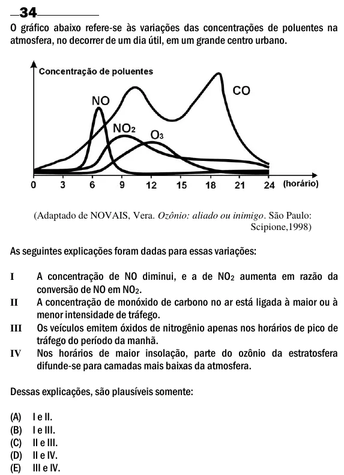

Texto extraído (pode conter ruído)

34  
O gráfico abaixo refere-se às variações das concentrações de poluentes na  
atmosfera, no decorrer de um dia útil, em um grande centro urbano.  
(Adaptado de NOVAIS, Vera. Ozônio: aliado ou inimigo. São Paulo:  
Scipione,1998)  
As seguintes explicações foram dadas para essas variações:  
A concentração de NO diminui, e a de NO 2 aumenta em razão da  
I  
conversão de NO em NO 2 .  
A concentração de monóxido de carbono no ar está ligada à maior ou à  
II  
menor intensidade de tráfego.  
Os veículos emitem óxidos de nitrogênio apenas nos horários de pico de  
III  
tráfego do período da manhã.  
IV  
Nos horários de maior insolação, parte do ozônio da estratosfera  
difunde-se para camadas mais baixas da atmosfera.  
Dessas explicações, são plausíveis somente:  
(A)  
I e II.  
(B)  
I e III.  
(C)  
II e III.  
(D)  
II e IV.  
(E)  
III e IV.

