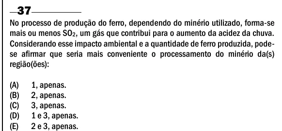

Texto extraído (pode conter ruído)

37  
No processo de produção do ferro, dependendo do minério utilizado, forma-se  
mais ou menos SO 2 , um gás que contribui para o aumento da acidez da chuva.  
Considerando esse impacto ambiental e a quantidade de ferro produzida, pode-  
se afirmar que seria mais conveniente o processamento do minério da(s)  
região(ões):  
(A)  
1, apenas.  
(B)  
2, apenas.  
(C)  
3, apenas.  
(D)  
1 e 3, apenas.  
(E)  
2 e 3, apenas.

