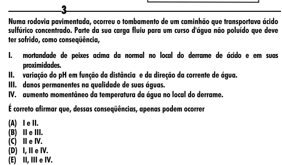

Texto extraído (pode conter ruído)

3  
Numa rodovia pavimentada, ocorreu o tombamento de um caminhão que transportava ácido  
sulfúrico concentrado. Parte da sua carga fluiu para um curso d'água não poluído que deve  
ter sofrido, como conseqüência,  
I.  
mortandade de peixes acima da normal no local do derrame de ácido e em suas  
proximidades.  
II. variação do pH em função da distância e da direção da corrente de água.  
III. danos permanentes na qualidade de suas águas.  
IV. aumento momentâneo da temperatura da água no local do derrame.  
É correto afirmar que, dessas conseqüências, apenas podem ocorrer  
(A) I e II.  
(B) II e III.  
(C) II e IV.  
(D) I, II e IV.  
(E) II, III e IV.

