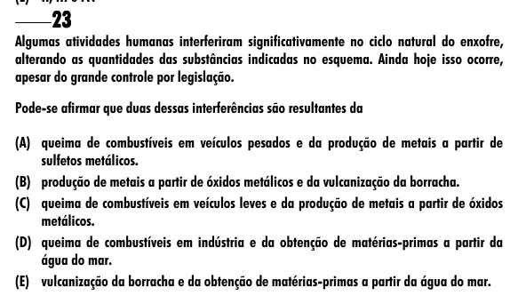

Texto extraído (pode conter ruído)

23  
Algumas atividades humanas interferiram significativamente no ciclo natural do enxofre,  
alterando as quantidades das substâncias indicadas no esquema. Ainda hoje isso ocorre,  
apesar do grande controle por legislação.  
Pode-se afirmar que duas dessas interferências são resultantes da  
(A) queima de combustíveis em veículos pesados e da produção de metais a partir de  
sulfetos metálicos.  
(B) produção de metais a partir de óxidos metálicos e da vulcanização da borracha.  
(C) queima de combustíveis em veículos leves e da produção de metais a partir de óxidos  
metálicos.  
(D) queima de combustíveis em indústria e da obtenção de matérias-primas a partir da  
água do mar.  
(E) vulcanização da borracha e da obtenção de matérias-primas a partir da água do mar.

