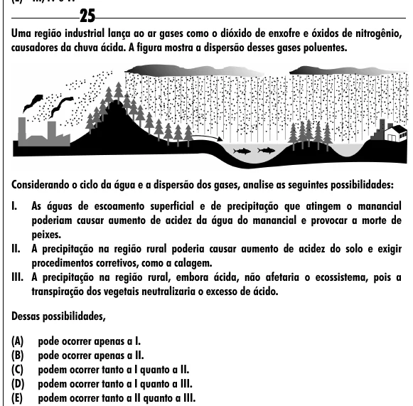

Texto extraído (pode conter ruído)

25  
Uma região industrial lança ao ar gases como o dióxido de enxofre e óxidos de nitrogênio,  
causadores da chuva ácida. A figura mostra a dispersão desses gases poluentes.  
Considerando o ciclo da água e a dispersão dos gases, analise as seguintes possibilidades:  
I.  
As águas de escoamento superficial e de precipitação que atingem o manancial  
poderiam causar aumento de acidez da água do manancial e provocar a morte de  
peixes.  
II. A precipitação na região rural poderia causar aumento de acidez do solo e exigir  
procedimentos corretivos, como a calagem.  
III. A precipitação na região rural, embora ácida, não afetaria o ecossistema, pois a  
transpiração dos vegetais neutralizaria o excesso de ácido.  
Dessas possibilidades,  
(A)  
pode ocorrer apenas a I.  
(B)  
pode ocorrer apenas a II.  
(C)  
podem ocorrer tanto a I quanto a II.  
(D)  
podem ocorrer tanto a I quanto a III.  
(E)  
podem ocorrer tanto a II quanto a III.

