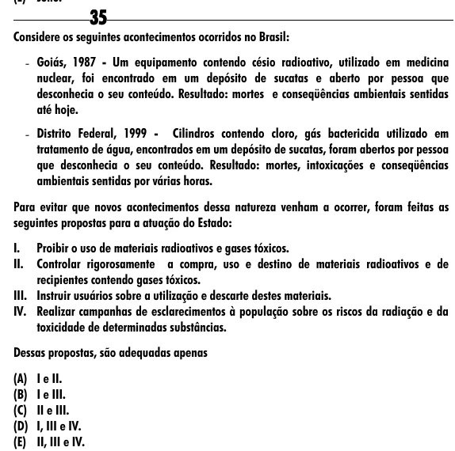

Texto extraído (pode conter ruído)

35  
Considere os seguintes acontecimentos ocorridos no Brasil:  
- Goiás, 1987 - Um equipamento contendo césio radioativo, utilizado em medicina  
nuclear, foi encontrado em um depósito de sucatas e aberto por pessoa que  
desconhecia o seu conteúdo. Resultado: mortes e conseqüências ambientais sentidas  
até hoje.  
- Distrito Federal, 1999 - Cilindros contendo cloro, gás bactericida utilizado em  
tratamento de água, encontrados em um depósito de sucatas, foram abertos por pessoa  
que desconhecia o seu conteúdo. Resultado: mortes, intoxicações e conseqüências  
ambientais sentidas por várias horas.  
Para evitar que novos acontecimentos dessa natureza venham a ocorrer, foram feitas as  
seguintes propostas para a atuação do Estado:  
I.  
Proibir o uso de materiais radioativos e gases tóxicos.  
II.  
Controlar rigorosamente a compra, uso e destino de materiais radioativos e de  
recipientes contendo gases tóxicos.  
III. Instruir usuários sobre a utilização e descarte destes materiais.  
IV. Realizar campanhas de esclarecimentos à população sobre os riscos da radiação e da  
toxicidade de determinadas substâncias.  
Dessas propostas, são adequadas apenas  
(A) I e II.  
(B) I e III.  
(C) II e III.  
(D) I, III e IV.  
(E) II, III e IV.

