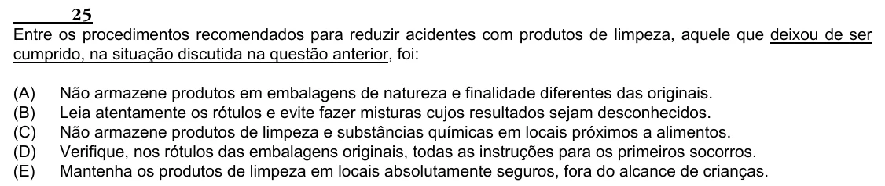

Texto extraído (pode conter ruído)

25  
Entre os procedimentos recomendados para reduzir acidentes com produtos de limpeza, aquele que deixou de ser  
cumprido, na situação discutida na questão anterior, foi:  
(A)  
Não armazene produtos em embalagens de natureza e finalidade diferentes das originais.  
(B)  
Leia atentamente os rótulos e evite fazer misturas cujos resultados sejam desconhecidos.  
(C)  
Não armazene produtos de limpeza e substâncias químicas em locais próximos a alimentos.  
(D)  
Verifique, nos rótulos das embalagens originais, todas as instruções para os primeiros socorros.  
(E)  
Mantenha os produtos de limpeza em locais absolutamente seguros, fora do alcance de crianças.

