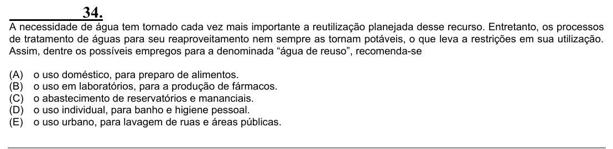

Texto extraído (pode conter ruído)

34.  
A necessidade de água tem tornado cada vez mais importante a reutilização planejada desse recurso. Entretanto, os processos  
de tratamento de águas para seu reaproveitamento nem sempre as tornam potáveis, o que leva a restrições em sua utilização.  
Assim, dentre os possíveis empregos para a denominada “água de reuso”, recomenda-se  
(A)  
o uso doméstico, para preparo de alimentos.  
(B)  
o uso em laboratórios, para a produção de fármacos.  
(C)  
o abastecimento de reservatórios e mananciais.  
(D)  
o uso individual, para banho e higiene pessoal.  
(E)  
o uso urbano, para lavagem de ruas e áreas públicas.

