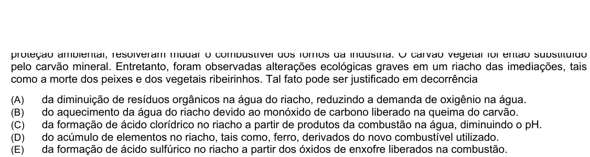

Texto extraído (pode conter ruído)

pelo carvão mineral. Entretanto, foram observadas alterações ecológicas graves em um riacho das imediações, tais  
como a morte dos peixes e dos vegetais ribeirinhos. Tal fato pode ser justificado em decorrência  
(A)  
da diminuição de resíduos orgânicos na água do riacho, reduzindo a demanda de oxigênio na água.  
do aquecimento da água do riacho devido ao monóxido de carbono liberado na queima do carvão.  
(B)  
da formação de ácido clorídrico no riacho a partir de produtos da combustão na água, diminuindo o pH.  
(C)  
(D)  
do acúmulo de elementos no riacho, tais como, ferro, derivados do novo combustível utilizado.  
(E)  
da formação de ácido sulfúrico no riacho a partir dos óxidos de enxofre liberados na combustão.

