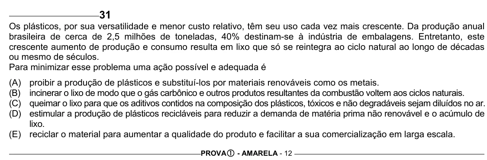

Texto extraído (pode conter ruído)

31  
Os plásticos, por sua versatilidade e menor custo relativo, têm seu uso cada vez mais crescente. Da produção anual  
brasileira de cerca de 2,5 milhões de toneladas, 40% destinam-se à indústria de embalagens. Entretanto, este  
crescente aumento de produção e consumo resulta em lixo que só se reintegra ao ciclo natural ao longo de décadas  
ou mesmo de séculos.  
Para minimizar esse problema uma ação possível e adequada é  
(A)  
proibir a produção de plásticos e substituí-los por materiais renováveis como os metais.  
(B)  
incinerar o lixo de modo que o gás carbônico e outros produtos resultantes da combustão voltem aos ciclos naturais.  
(C)  
queimar o lixo para que os aditivos contidos na composição dos plásticos, tóxicos e não degradáveis sejam diluídos no ar.  
(D)  
estimular a produção de plásticos recicláveis para reduzir a demanda de matéria prima não renovável e o acúmulo de  
lixo.  
(E) reciclar o material para aumentar a qualidade do produto e facilitar a sua comercialização em larga escala.  
PROVA c - AMARELA - 12

