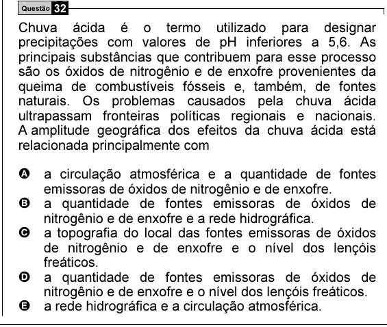

Texto extraído (pode conter ruído)

Questão 32  
Chuva ácida é o termo utilizado para designar  
precipitações com valores de pH inferiores a 5,6. As  
principais substâncias que contribuem para esse processo  
são os óxidos de nitrogênio e de enxofre provenientes da  
queima de combustíveis fósseis e, também, de fontes  
naturais. Os problemas causados pela chuva ácida  
ultrapassam fronteiras políticas regionais e nacionais.  
A amplitude geográfica dos efeitos da chuva ácida está  
relacionada principalmente com  
A a circulação atmosférica e a quantidade de fontes  
emissoras de óxidos de nitrogênio e de enxofre.  
B a quantidade de fontes emissoras de óxidos de  
nitrogênio e de enxofre e a rede hidrográfica.  
C a topografia do local das fontes emissoras de óxidos  
de nitrogênio e de enxofre e o nível dos lençóis  
freáticos.  
D a quantidade de fontes emissoras de óxidos de  
nitrogênio e de enxofre e o nível dos lençóis freáticos.  
E a rede hidrográfica e a circulação atmosférica.

