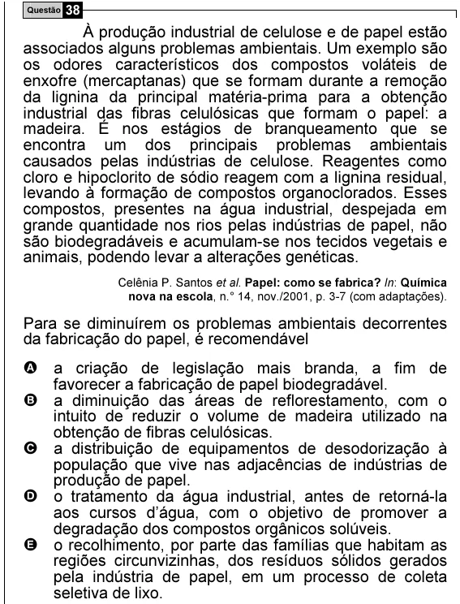

Texto extraído (pode conter ruído)

Questão 38  
À produção industrial de celulose e de papel estão  
associados alguns problemas ambientais. Um exemplo são  
os odores característicos dos compostos voláteis de  
enxofre (mercaptanas) que se formam durante a remoção  
da lignina da principal matéria-prima para a obtenção  
industrial das fibras celulósicas que formam o papel: a  
madeira. É nos estágios de branqueamento que se  
encontra um dos principais problemas ambientais  
causados pelas indústrias de celulose. Reagentes como  
cloro e hipoclorito de sódio reagem com a lignina residual,  
levando à formação de compostos organoclorados. Esses  
compostos, presentes na água industrial, despejada em  
grande quantidade nos rios pelas indústrias de papel, não  
são biodegradáveis e acumulam-se nos tecidos vegetais e  
animais, podendo levar a alterações genéticas.  
Celênia P. Santos et al. Papel: como se fabrica? In: Química  
nova na escola, n.° 14, nov./2001, p. 3-7 (com adaptações).  
Para se diminuírem os problemas ambientais decorrentes  
da fabricação do papel, é recomendável  
A a criação de legislação mais branda, a fim de  
favorecer a fabricação de papel biodegradável.  
B a diminuição das áreas de reflorestamento, com o  
intuito de reduzir o volume de madeira utilizado na  
obtenção de fibras celulósicas.  
C a distribuição de equipamentos de desodorização à  
população que vive nas adjacências de indústrias de  
produção de papel.  
D o tratamento da água industrial, antes de retorná-la  
aos cursos d’água, com o objetivo de promover a  
degradação dos compostos orgânicos solúveis.  
E o recolhimento, por parte das famílias que habitam as  
regiões circunvizinhas, dos resíduos sólidos gerados  
pela indústria de papel, em um processo de coleta  
seletiva de lixo.

