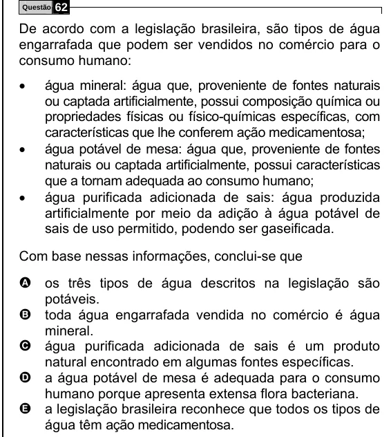

Texto extraído (pode conter ruído)

Questão  
62  
De acordo com a legislação brasileira, são tipos de água  
engarrafada que podem ser vendidos no comércio para o  
consumo humano:  
•  
água mineral: água que, proveniente de fontes naturais  
ou captada artificialmente, possui composição química ou  
propriedades físicas ou físico-químicas específicas, com  
características que lhe conferem ação medicamentosa;  
•  
água potável de mesa: água que, proveniente de fontes  
naturais ou captada artificialmente, possui características  
que a tornam adequada ao consumo humano;  
•  
água purificada adicionada de sais: água produzida  
artificialmente por meio da adição à água potável de  
sais de uso permitido, podendo ser gaseificada.  
Com base nessas informações, conclui-se que  
A os três tipos de água descritos na legislação são  
potáveis.  
B toda água engarrafada vendida no comércio é água  
mineral.  
C água purificada adicionada de sais é um produto  
natural encontrado em algumas fontes específicas.  
D a água potável de mesa é adequada para o consumo  
humano porque apresenta extensa flora bacteriana.  
E a legislação brasileira reconhece que todos os tipos de  
água têm ação medicamentosa.

