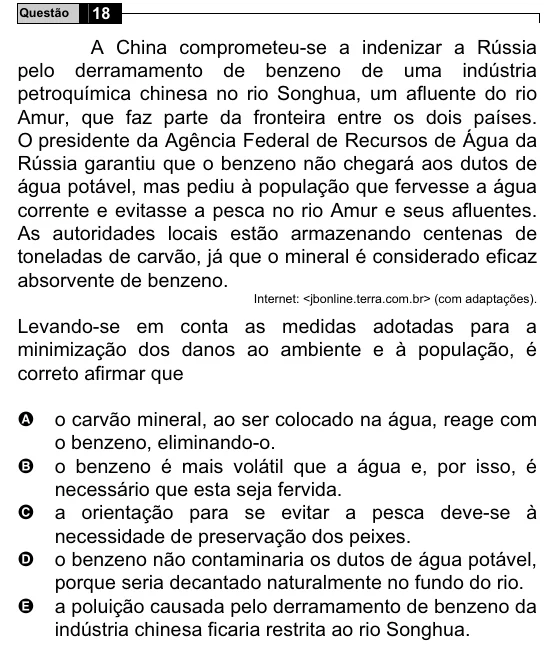

Texto extraído (pode conter ruído)

Questão  
18  
A China comprometeu-se a indenizar a Rússia  
pelo derramamento de benzeno de uma indústria  
petroquímica chinesa no rio Songhua, um afluente do rio  
Amur, que faz parte da fronteira entre os dois países.  
O presidente da Agência Federal de Recursos de Água da  
Rússia garantiu que o benzeno não chegará aos dutos de  
água potável, mas pediu à população que fervesse a água  
corrente e evitasse a pesca no rio Amur e seus afluentes.  
As autoridades locais estão armazenando centenas de  
toneladas de carvão, já que o mineral é considerado eficaz  
absorvente de benzeno.  
Internet: <jbonline.terra.com.br> (com adaptações).  
Levando-se em conta as medidas adotadas para a  
minimização dos danos ao ambiente e à população, é  
correto afirmar que  
o carvão mineral, ao ser colocado na água, reage com  
A  
o benzeno, eliminando-o.  
B  
o benzeno é mais volátil que a água e, por isso, é  
necessário que esta seja fervida.  
a orientação para se evitar a pesca deve-se à  
C  
necessidade de preservação dos peixes.  
D  
o benzeno não contaminaria os dutos de água potável,  
porque seria decantado naturalmente no fundo do rio.  
a poluição causada pelo derramamento de benzeno da  
E  
indústria chinesa ficaria restrita ao rio Songhua.

