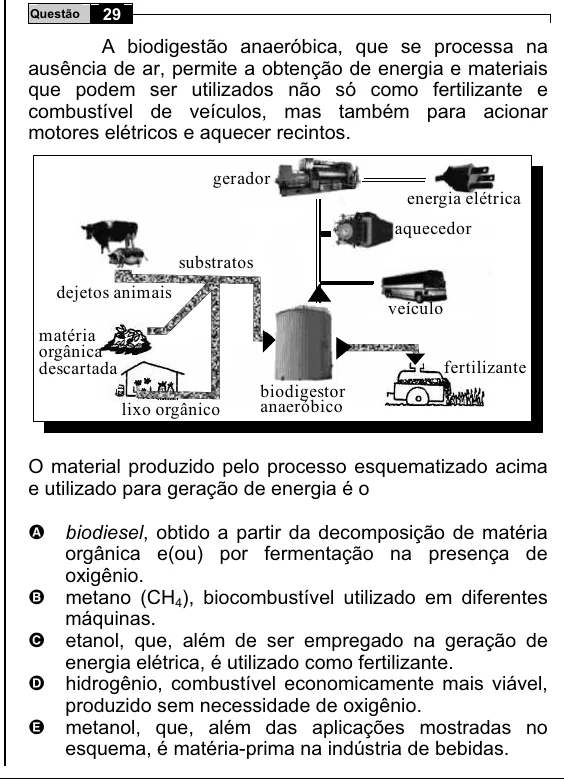

Texto extraído (pode conter ruído)

29  
Questão  
A biodigestão anaeróbica, que se processa na  
ausência de ar, permite a obtenção de energia e materiais  
que podem ser utilizados não só como fertilizante e  
combustível de veículos, mas também para acionar  
motores elétricos e aquecer recintos.  
gerador  
energia elétrica  
aquecedor  
substratos  
dejetos animais  
veículo  
matéria  
orgânica  
fertilizante  
descartada  
biodigestor  
lixo orgânico  
anaeróbico  
O material produzido pelo processo esquematizado acima  
e utilizado para geração de energia é o  
biodiesel, obtido a partir da decomposição de matéria  
A  
orgânica e(ou) por fermentação na presença de  
oxigênio.  
metano (CH 4 ), biocombustível utilizado em diferentes  
B  
máquinas.  
etanol, que, além de ser empregado na geração de  
C  
energia elétrica, é utilizado como fertilizante.  
hidrogênio, combustível economicamente mais viável,  
D  
produzido sem necessidade de oxigênio.  
metanol, que, além das aplicações mostradas no  
E  
esquema, é matéria-prima na indústria de bebidas.

