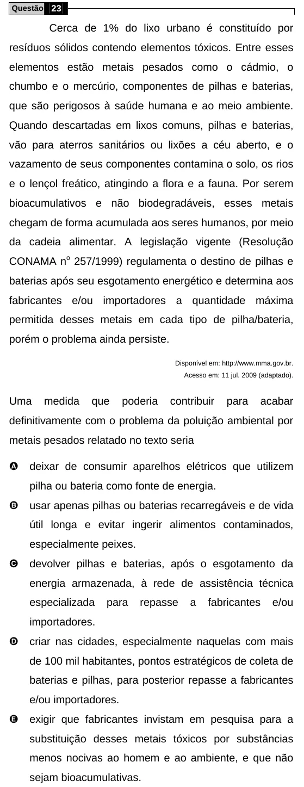

Texto extraído (pode conter ruído)

Questão 23  
Cerca de 1% do lixo urbano é constituído por  
resíduos sólidos contendo elementos tóxicos. Entre esses  
elementos estão metais pesados como o cádmio, o  
chumbo e o mercúrio, componentes de pilhas e baterias,  
que são perigosos à saúde humana e ao meio ambiente.  
Quando descartadas em lixos comuns, pilhas e baterias,  
vão para aterros sanitários ou lixões a céu aberto, e o  
vazamento de seus componentes contamina o solo, os rios  
e o lençol freático, atingindo a flora e a fauna. Por serem  
bioacumulativos e não biodegradáveis, esses metais  
chegam de forma acumulada aos seres humanos, por meio  
da cadeia alimentar. A legislação vigente (Resolução  
CONAMA n o 257/1999) regulamenta o destino de pilhas e  
baterias após seu esgotamento energético e determina aos  
fabricantes e/ou importadores a quantidade máxima  
permitida desses metais em cada tipo de pilha/bateria,  
porém o problema ainda persiste.  
Disponível em: http://www.mma.gov.br.  
Acesso em: 11 jul. 2009 (adaptado).  
Uma  
medida  
que  
poderia  
contribuir  
para  
acabar  
definitivamente com o problema da poluição ambiental por  
metais pesados relatado no texto seria  
A  
deixar de consumir aparelhos elétricos que utilizem  
pilha ou bateria como fonte de energia.  
B  
usar apenas pilhas ou baterias recarregáveis e de vida  
útil longa e evitar ingerir alimentos contaminados,  
especialmente peixes.  
C  
devolver pilhas e baterias, após o esgotamento da  
energia armazenada, à rede de assistência técnica  
especializada  
para  
repasse  
a  
fabricantes  
e/ou  
importadores.  
D  
criar nas cidades, especialmente naquelas com mais  
de 100 mil habitantes, pontos estratégicos de coleta de  
baterias e pilhas, para posterior repasse a fabricantes  
e/ou importadores.  
E  
exigir que fabricantes invistam em pesquisa para a  
substituição desses metais tóxicos por substâncias  
menos nocivas ao homem e ao ambiente, e que não  
sejam bioacumulativas.

