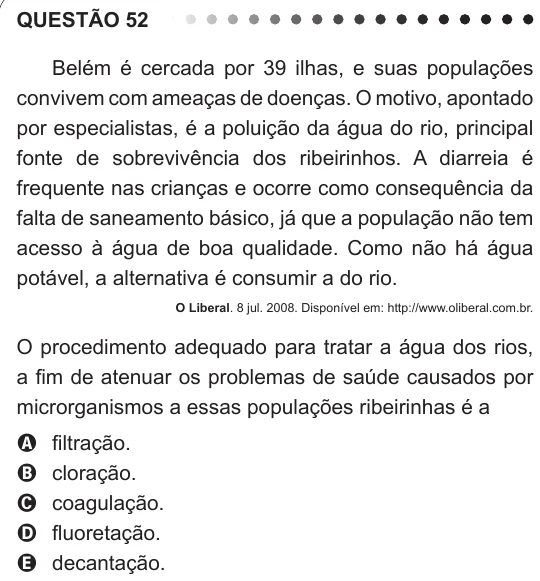

Texto extraído (pode conter ruído)

QUESTÃO 52  
Belém é cercada por 39 ilhas, e suas populações  
convivem com ameaças de doenças. O motivo, apontado  
por especialistas, é a poluição da água do rio, principal  
fonte de sobrevivência dos ribeirinhos. A diarreia é  
frequente nas crianças e ocorre como consequência da  
falta de saneamento básico, já que a população não tem  
acesso à água de boa qualidade. Como não há água  
potável, a alternativa é consumir a do rio.  
O Liberal. 8 jul. 2008. Disponível em: http://www.oliberal.com.br.  
O procedimento adequado para tratar a água dos rios,  
a fim de atenuar os problemas de saúde causados por  
microrganismos a essas populações ribeirinhas é a  
filtração.  
A  
cloração.  
B  
C  
coagulação.  
fluoretação.  
D  
decantação.  
E

