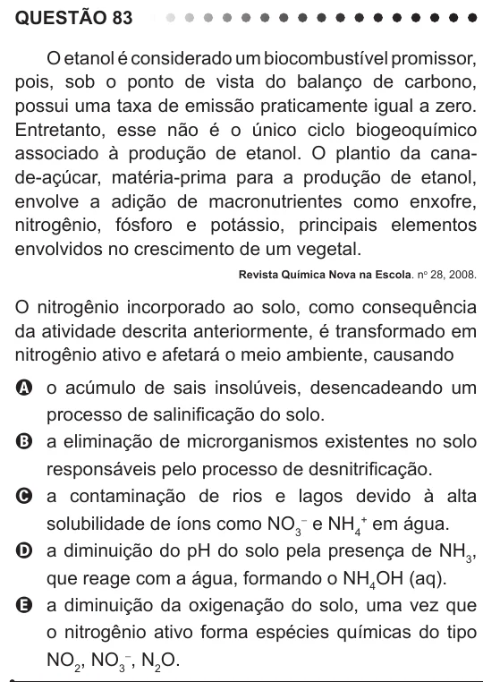

Texto extraído (pode conter ruído)

QUESTÃO 83  
O etanol é considerado um biocombustível promissor,  
pois, sob o ponto de vista do balanço de carbono,  
possui uma taxa de emissão praticamente igual a zero.  
Entretanto, esse não é o único ciclo biogeoquímico  
associado à produção de etanol. O plantio da cana-  
de-açúcar, matéria-prima para a produção de etanol,  
envolve a adição de macronutrientes como enxofre,  
nitrogênio, fósforo e potássio, principais elementos  
envolvidos no crescimento de um vegetal.  
Revista Química Nova na Escola. n o 28, 2008.  
O nitrogênio incorporado ao solo, como consequência  
da atividade descrita anteriormente, é transformado em  
nitrogênio ativo e afetará o meio ambiente, causando  
A o acúmulo de sais insolúveis, desencadeando um  
processo de salinificação do solo.  
B a eliminação de microrganismos existentes no solo  
responsáveis pelo processo de desnitrificação.  
C a contaminação de rios e lagos devido à alta  
solubilidade de íons como NO 3 - e NH 4+ em água.  
D a diminuição do pH do solo pela presença de NH 3 ,  
que reage com a água, formando o NH 4 OH (aq).  
E a diminuição da oxigenação do solo, uma vez que  
o nitrogênio ativo forma espécies químicas do tipo  
NO 2 , NO 3 - , N 2 O.

